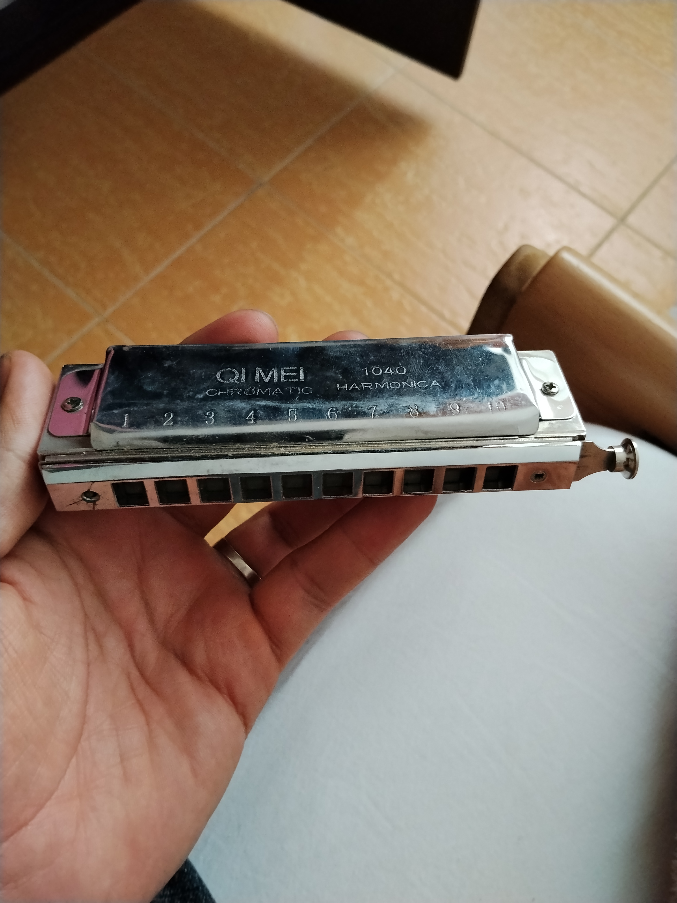

# Kimi-1040 — تبدیل نت به تبلچر هارمونیکای کروماتیک | Chromatic Harmonica Tab Converter



**فارسی:** برنامهٔ وبِ تبدیل نتی به تبلچر عددی، مخصوص هارمونیکای کروماتیک **QI MEI 1040**
(۱۰ خانه / ۴۰ زبانه، کوک C، با اسلایدر). نام آهنگ را می‌دهید → بهترین و کامل‌ترین نسخهٔ نت
از اینترنت پیدا می‌شود → به تبلچر عددی تبدیل می‌شود → خروجی **PDF + MIDI + MP3** با **متن آهنگ سینک‌شده** می‌گیرید.

**English:** A web app that converts song notes into numeric tablature for the
**QI MEI 1040** chromatic harmonica (10 holes / 40 reeds, key of C, with slide).
Give it a song name → it finds the best/most complete version of the notes on the internet →
converts them to numeric tab → exports **PDF + MIDI + MP3** with **time-synced lyrics**.

---

## اجرا / Run

- ساده‌ترین راه / simplest: بازکردن `index.html` در مرورگر (حتی بدون اینترنت) — open `index.html` in any browser, works offline.
- یا / or: `python3 -m http.server 8080` و سپس / then `http://localhost:8080`
- روی موبایل/تبلت: همان مرورگر؛ برنامه PWA است و قابل نصب و آفلاین است (منوی Add to Home Screen).
  On phones/tablets: same browser; it is an installable, offline-capable PWA.
- همه‌چیز سمت کلاینت اجرا می‌شود؛ هیچ سروری لازم نیست. Everything runs client-side; no server needed.

## ورودی نت / Note input

1. **جستجو در اینترنت / Internet search:** نام آهنگ به هر زبانی. جستجو در آرشیو MIDI اینترنت
   (archive.org) و Wikimedia Commons؛ چند نامزد تجزیه می‌شود و **بهترین/کامل‌ترین** (بیشترین نت،
   تک‌صدایی‌تر، مناسب‌ترین گستره) خودکار انتخاب می‌شود؛ بقیهٔ نتایج برای انتخاب دستی فهرست می‌شوند.
   Search any song name in any language across the Internet Archive MIDI collection and Wikimedia
   Commons; several candidates are parsed and the **best/most complete** one is auto-picked.
2. **کتابخانهٔ داخلی / Built-in library:** چند آهنگ آفلاین با متن سینک‌شده.
3. **فایل MIDI / MIDI file:** آپلود از دستگاه؛ ملودی اصلی خودکار استخراج می‌شود.
4. **تایپ نت / Type notes:** مثلاً / e.g. `T:=110 M:=4/4  E4 E4 F4:q G4/e R |`

## چیدمان نت روی ساز / Note layout (QI MEI 1040, key of C, solo tuning)

| خانه / Hole | 1 | 2 | 3 | 4 | 5 | 6 | 7 | 8 | 9 | 10 |
|---|---|---|---|---|---|---|---|---|---|---|
| دمش / Blow | C4 | E4 | G4 | C5 | C5 | E5 | G5 | C6 | C6 | E6 |
| مکش / Draw | D4 | F4 | A4 | B4 | D5 | F5 | A5 | B5 | D6 | F6 |
| دمش+اسلایدر / Blow+slide | C#4 | F4 | G#4 | C#5 | C#5 | F5 | G#5 | C#6 | C#6 | F6 |
| مکش+اسلایدر / Draw+slide | D#4 | F#4 | A#4 | C5 | D#5 | F#5 | A#5 | C6 | D#6 | F#6 |

گستره / range: **C4 تا F6** (با اسلایدر تا F#6) — کاملاً کروماتیک / fully chromatic.

## خواندن تبلچر / Reading the tab

| نماد / Symbol | معنی / Meaning |
|---|---|
| `4` | دمش در خانهٔ  / blow hole 4 |
| `-4` | مکش در خانهٔ ۴ / draw hole 4 |
| `4*` / `-4*` | اسلایدر (کلید) فشرده / slide (button) pressed |
| `0` | سکوت / rest |
| `-` بعد از عدد / after a number | ادامهٔ نت / tie (hold) |
| `.` | نت نقطه‌دار / dotted |
| یک زیرخط / one underline | چنگ ۱/۸ / eighth note |
| دو زیرخط / two underlines | دولاچنگ ۱/۱۶ / sixteenth note |

تبلچر با الگوریتم ارگونومیک انتخاب انگشتگذاری می‌شود: کمترین پرش خانه، کمترین تعویض
اسلایدر، و ترجیح دمش/مکش ساده بر اسلایدر. ترانسپوز خودکار آهنگ را داخل گسترهٔ ساز می‌برد.
Fingerings are chosen ergonomically (minimal hole jumps, minimal slide changes, plain breath
preferred); auto-transpose keeps the melody inside the harp range.

## خروجی‌ها / Outputs

- **PDF:**sheet کامل دوزبانه (فارسی/انگلیسی) با متن آهنگ سینک‌شده بالای هر نت، نام نت،
  خط میزان، شمارهٔ میزان، ضرباهنگ، کسر میزان، راهنمای علائم — فونت وزیرمتن (فارسی کامل).
  Full bilingual sheet: synced lyrics above each note, pitch names, bar lines & numbers,
  tempo, time signature, legend — full Persian shaping via Vazirmatn.
- **MIDI:** فایل استاندارد نوع ۱ با برنامهٔ GM «هارمونیکا»، رویداد LYRIC سینک‌شده با هر نت
  (متن آهنگ داخل خود MIDI) و رویداد TEXT شامل عدد تبلچر هر نت.
  Type-1 SMF, GM "Harmonica" program, per-note synced LYRIC meta events + tab numbers as TEXT events.
- **MP3:** سنتز صدای هارمونیکا (تنفس، ویبراتو، هارمونیک‌ها، اسکوپ اسلایدر) + تگ ID3v2 شامل
  `USLT` (کل متن) و `SYLT` (متن سینک‌شده میلی‌ثانیه‌ای) داخل خود فایل MP3.
  Harmonica-like synthesis + ID3v2 tag embedding full lyrics (USLT) and millisecond-synced lyrics (SYLT).
- **LRC:** فایل متن سینک‌شده برای پلیرها / synced-lyrics file for players.
- **JSON:** دادهٔ کامل آهنگ و تبلچر / full song + tab data.

## توسعه / Development

```
npm install        # فقط برای تست‌ها (jsdom) / tests only
npm test           # unit + jsdom integration tests
```

ساختار / structure: `js/harp.js` (کوک و انگشتگذاری), `js/search.js` (جستجوی اینترنت),
`js/melody.js` (استخراج ملودی از MIDI), `js/midiwrite.js`, `js/exportmp3.js` (lamejs + ID3),
`js/exportpdf.js` (html2canvas + jsPDF), `js/synth.js` (سنتز), `js/library.js`, `js/i18n.js`.
کتابخانه‌ها و فونت وزیرمتن به‌صورت محلی/embedded هستند → اجرای کامل آفلاین.
All libraries and the Vazirmatn font are vendored/embedded → full offline operation.

مجوزها / licenses: code MIT; Vazirmatn font SIL OFL; built-in melodies public domain;
lamejs LGPL; jsPDF MIT; html2canvas MIT.
